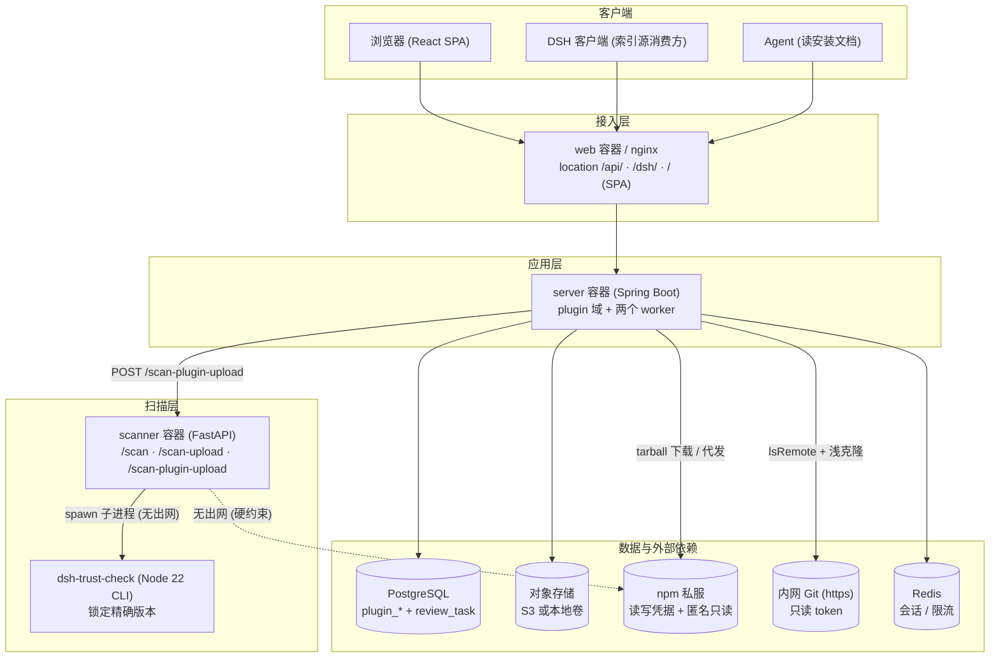
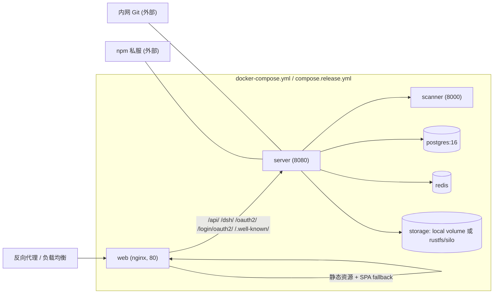
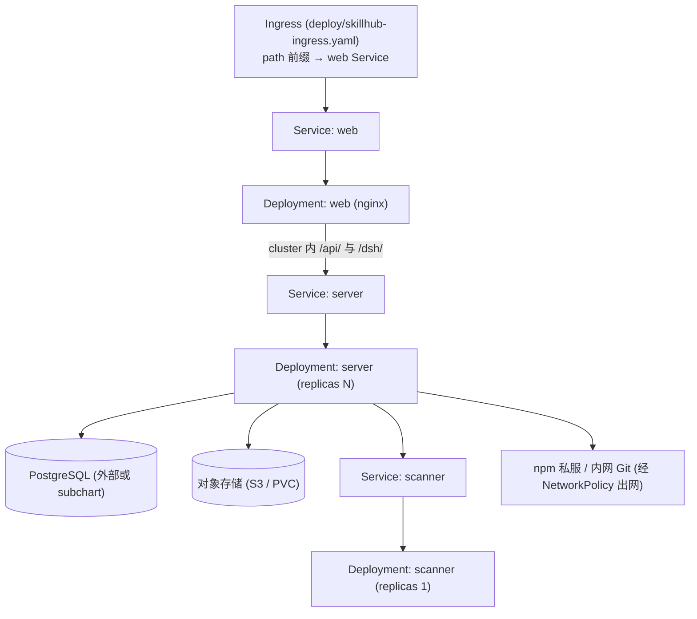

# §1–§2　设计目标与约束、十项架构决策映射、系统全景与部署拓扑

> 所属：总体设计　｜　覆盖章节：§1–§2
> 章节号全局唯一、不随文件移动；跨文件引用写 `§N.M`，不要写文件名。索引见 [`README.md`](README.md)。

# Design — DSH 插件市场 v1.0

> 需求来源：`../../../../docs/prds/plugin-market/plugin-market-v1.0-prd.md`（现行 **v2.20（2026-11-27 冻结，461 行，13 节 / 27 条验收；状态 Frozen（已与 design 对齐）），章节号自 v2.1 起未变）、`../../../../docs/prds/plugin-market/plugin-market-v1.0-prototype.html`（9 屏 S01–S09）。v2.13 的 npm 裁决已同步进本文 §3.4/§4.1/§4.2/§6.2/§7.3/§7.4/§10.5/§13/§14.1/§16；**v2.14 新增「审核页可查看包内文件内容」**，已同步进 §1.3 D10、§3.2、§3.3、§3.4、§4.7、§5.3、§6.4、§7.2、§7.3、§7.4、§7.5、§7.6、§10.2、§10.3、§10.5、§10.6、§11.1、§12.1、§12.3、§13 #19、§14.1 A17/A18、§15、§16。**v2.19 同步 11 条裁决**（① 卡片显示复制次数、② 详情页删披露区块、③ 版本列去裁决徽标、⑤ 版本标注、⑥ 市场页去协议/安全提示、⑦ 平铺两段、⑧ 版本列表来源只 npm/git、⑨ 提交两步 + 确认弹窗、⑩ 返回入口、⑪ 发布技能仅产品意图）；④ 为核对项（zip 面板内部字段名已删、符合红线，design 无需改）。落点逐条见 `README.md` §5 第 7 条；判定规则 / 四裁决 / 扫描契约 / 证据生成本身一概未改。**v2.20 同步 4 项裁决**（① 状态位不变、② 产品目标 4 删除 + 用户侧披露全撤——扫描只作上架闸门 + 治理侧审核、③ 提交页返回固定回 `/dashboard/plugins`、④ 原型旧措辞修复：显示名称可改 / 详情不展示等价命令 / 排序补复制最多 + 仅看收藏）；**判定规则 / 四裁决 / 扫描契约 / 治理侧完整报告一概未动**。落点见 `README.md` §5 第 7 条。
> 本文是**总体方案 + 详细设计**的单一权威正文：DDL、接口、状态机、时序、部署与分期全部在此，不另建第二套设计文档。
> 术语严格按 `PRD §2`：本文所说的「插件」一律指 **DSH 插件**（npm 包 + `dsh.bundle`），与 **SkillHub 技能**（`SKILL.md`）是两套资产。
> 文案契约：全站禁止出现「安全 / 已认证 / 无风险 / 通过安全检测」，只允许「未检出风险信号 / 需确认 / 有红线 / 管理员已确认风险」。

---

## 1. 设计目标与约束

### 1.1 目标

1. `/dsh/*` 三个读路径（索引、图标、安装文档）在任意部署形态（根路径 / 子路径）下都能被 DSH 匿名、无重定向、正确解析。
2. 四种提交来源收敛为官方协议允许的两种分发来源（`npm` / `git`），且**被扫描的字节 = 被分发的字节**。
3. 提交链路任何一步失败都可解释、可重试、可审计，且**不产生半成品状态**（不留私服凭证、不留 `name@version` 占位、不留残缺索引）。
4. 索引文件对 DSH 是"一次都不能错"的强契约；本站自身不可感知 DSH 端的拒绝，因此错误必须在本站生成期被拦住。
5. 扫描结论只作**上架闸门 + 治理侧审核依据**（v2.20：用户侧不展示任何披露），不做安全背书；裁决只有四态且 `error` 一律 fail closed。

### 1.2 约束（来自既有代码与规范）

| 约束 | 事实依据 | 对设计的影响 |
|---|---|---|
| 后端 7 个 Maven 模块，无 plugin 域代码 | `server/pom.xml`、`grep -ri plugin server/*/src/main/java` 仅命中 `BuiltinSkillPublicationService`、`RecommendationDefaults` 的普通词 | 不新增 Maven 模块，plugin 落在 domain/app/infra 三个既有模块内 |
| 迁移低段已用满 V1..V126，高位段 `V10000` 属 `remove-github-sync` | `db/migration/` 共 127 个文件；`V104__github_sync_worker_presence.sql` 存在 | 新迁移必须落 fork 高位段，且不占用 `V10000`（见 §6.1） |
| 迁移守卫按"低段连续 + 高位段无重复"实施 | `FlywayMigrationGuardrailTest:56-84`，`FORK_VERSION_FLOOR = 10000` | 高位段允许跳号，可按变更块整段分配 |
| 对象存储无 rename | `ObjectStorageService` 只有 `putObject/getObject/deleteObject/exists/getMetadata/generatePresignedUrl` | 索引发布改为"版本化键（不可变）+ 指针键（覆盖 PUT）"，指针 PUT 本身原子 |
| JVM 镜像无 `git` 二进制 | `server/Dockerfile:32` 只装 `wget` | Git 来源解析用 JGit，不用子进程；镜像不需改动 |
| 扫描服务是 Python 包装层 | `scanner/skillhub_scanner_app.py`，`cisco-ai-skill-scanner==2.1.0` | 插件扫描作为**新路由**加在包装层，复用并发闸/超时/临时根/脱敏，不复用上游 router |
| scanner 镜像非 root、无 Node | `scanner/Dockerfile`（`python:3.11-slim-bookworm` + system user `app`） | 加 Node 22 与锁定版本 CLI；运行期禁 `npx` |
| 异步设施先例是 outbox + claim/lease | `ScanTaskOutboxDispatcher`、`ScanTaskOutbox.claim(now, lease)`、`ScanTaskOutboxJpaRepository` 的 `FOR UPDATE SKIP LOCKED` | 两个新 worker 与这套同构；不引入 ShedLock / advisory lock / 进程内事件 |
| `review_task` 已泛型化且 `subject_type` 无 CHECK 约束 | `V50__typed_review_subjects.sql`、`V1__init_schema.sql`（`subject_type` 属其它表） | 新枚举值不需要 DDL 变更，仅加部分唯一索引 |
| 审核决定带强副作用 | `ReviewService.approveCheckedTask` 直接 `skillVersionRepository.findById(...)` 并发布 Skill | `PLUGIN_VERSION` **不得**走 `ReviewService`，必须独立决策服务（见 §3.5） |
| 身份用 String | `AGENTS.md` | `created_by` / `submitted_by` 一律 `VARCHAR(255)` |
| domain 不返 DTO、复杂 join 放 app query repository | `AGENTS.md` | 索引拼装在 domain（纯函数），目录列表投影在 app query repository |

### 1.3 十项架构决策的落地映射

| # | 决策 | 落点 | 章节 |
|---|---|---|---|
| D1 | 交付物为一份 proposal + 一份 design，落 `openspec/changes/add-plugin-market/` | 本文件 + `proposal.md` | 全文 |
| D2 | npm registry 配置化，适配器接口先冻结；**强制匿名只读**为部署前置；凭据不进索引/文档/URL | `NpmRegistryPort` + `PluginRegistrySelfCheck` + 启动降级开关 | §3.4、§9.1、§11.4 |
| D3 | 提交改全异步状态机，HTTP 内只做毫秒级校验 | `plugin_submission` 表 + `PluginSubmissionWorker` + 轮询接口 | §4.1、§5.3、§7 |
| D4 | `/dsh/*` 唯一出口走后端；索引"版本化键 + 指针"；短 TTL 缓存 + ETag/304；安装文档实时渲染；无 CDN；无重定向 | `PluginIndexController` + `PluginIndexObjectStore` + `PluginIndexReadCache` | §4.3–4.5、§8 |
| D5 | 两个 worker 复用 claim/lease；索引重建用单行脏标记 + `gen` | `plugin_submission` 派发索引 + `plugin_index_state` | §4.2–4.3、§5.3–5.4 |
| D6 | 删除「仅收录」与 `download`；`package_name` 提交时 409 | `plugin_stat_event` 两事件；`uq_plugin_package_name_active` | §6.2、§7.4 |
| D7 | 不做协议 spike，风险由强校验 + CI 校验库 + P1 真机门禁兜底 | `PluginIndexAssembler.validate` + CI job + 出口条件 | §8.4、§11.6、§15 |
| **D8** | **闸门顺序：扫描 → 审核（仅团队空间）→ 代发 → 上架**（用户第二次裁决，覆盖 v2.2 的"先代发后审核"）：审核人批的是**尚未推送的暂存包**，通过后才代发；拒绝即终态，**无撤包动作** | `plugin_version` 的 `REVIEW_PENDING` / `APPROVED`（审核结论落库即生效）+ 代发失败停 `APPROVED` 可重试 + `PUBLISHED` 与整条撤包链路删除 | §4.2、§4.6、§5.2、§5.3、§14.1 A11 |
| **D9** | **提交入口可用性由服务端能力开关决定**（`PRD §6.1` 通用规则：不可用则置灰 + 说明，不隐藏）；前端不吃分期常量 | `GET /api/v1/plugins/submit-capabilities` + 空间侧 `pluginSubmitEnabled` + `SKILLHUB_PLUGIN_TEAM_SPACE_SUBMIT_ENABLED`（默认 false）+ 三处入口共用 `PluginSubmitButton` | §7.2、§10.1、§10.5、§11.1、§11.5、§15 |
| **D10** | **审核页可只读浏览暂存包内文件，但内容永不进入浏览器执行上下文**：数据源只有 `staged_tarball_key`（审核在代发前，私服无此包，**不回退**）；文本只以 `text/plain; charset=utf-8` + `nosniff` + `CSP sandbox` + `no-store` 返回，前端只用文本节点；路径三层防护、六项上限、超限拒绝而不截断 | `PluginSubmissionFileController` + `PluginStagedFileService` + `PluginArchiveReaderPort`（tgz 顺序遍历）+ `PluginStagedFileIndexCache`（键 = submissionId + sha512）+ `PluginFileBrowser` | §4.7、§6.4、§7.2、§7.6、§10.2、§14.1 A17/A18、§16 |

---

## 2. 系统全景

### 2.1 组件图

### 2.2 部署拓扑（compose）

要点：
- `/dsh/` 必须在 **nginx 层**直连 server，不能进 SPA fallback（`try_files $uri $uri/ /index.html`）。见 §11.2。
- scanner 不暴露到容器网络之外，只允许 server 访问；`docker-compose.yml` 中不给 scanner 发布端口（现状即如此，保持）。
- 子路径部署由 `docker-entrypoint.d/20-base-path.sh` 生成 `skillhub-base-path*.conf`，`/dsh/` 的 location 必须保留 `$skillhub_forwarded_prefix` 转发头，否则后端生成的绝对 URL 会丢前缀。

### 2.3 部署拓扑（Helm / K8s）

Helm 侧变更：
- `deploy/k8s/base` 与 `overlays` 增加 server 的 plugin 配置块（ConfigMap）+ 敏感项（Secret：`SKILLHUB_NPM_REGISTRY_TOKEN`、`SKILLHUB_PLUGIN_GIT_READ_TOKEN`；`transport=ssh` 时另挂 **SSH 私钥文件**与 `known_hosts`（0600，非 root 可读），**不要把私钥塞进环境变量**）。
- **不要**为 `/dsh/` 单独加 Ingress path：`/dsh/` 与 `/` 同属 web 入口，由 nginx 分流，避免两处路由规则各自演化。
- scanner replicas 保持 1：`MAX_CONCURRENT_SCANS=1` + 单进程僵尸回收语义（硬超时会 `os._exit(124)` 让容器重启），多副本会让"升级漂移重扫"并发不可控。

### 2.4 网络边界表

| 组件 | 入站 | 出站 | 持有凭据 | 说明 |
|---|---|---|---|---|
| web / nginx | 公网 | 仅 server、scanner 不需要 | 无 | `/dsh/` 直连 server，不做重定向 |
| server | web、scanner 回调不需要 | PG、Redis、对象存储、npm 私服、内网 Git（HTTPS 或 SSH 22）、scanner | npm publish token、git 只读 token / SSH 部署私钥、存储密钥、DB 口令 | **凭据唯一持有者**；索引/文档/日志均不得出现。SSH 模式需额外放通到 Git 的 22 端口（NetworkPolicy 单列一条 egress） |
| scanner | 仅 server | **无**（硬约束） | 无 | 静态扫描不需要网络；违反即视为部署错误 |
| PostgreSQL | 仅 server | 无 | 自带口令 | 不放公网 |
| 对象存储 | 仅 server | 无 | 存储密钥 | S3 端无需 rename 能力 |
| npm 私服 | server（读写）、DSH/用户（匿名只读） | — | 见 server | 匿名只读是硬前置（D2） |
| 内网 Git | 仅 server | — | 只读 deploy token（HTTPS）/ 部署私钥（SSH） | 只 `ls-remote` + 浅克隆，不跑构建；host 白名单 + 可选 path 前缀白名单（§3.4.1） |

---

