# §3.1–§3.2　新增包清单、类图

> 所属：后端　｜　覆盖章节：§3.1–§3.2
> 章节号全局唯一、不随文件移动；跨文件引用写 `§N.M`，不要写文件名。索引见 [`../README.md`](../README.md)。

## 3. 模块与分层

### 3.1 新增包清单

| 模块 | 包 | 内容 |
|---|---|---|
| `skillhub-domain` | `domain/plugin` | 实体、枚举、值对象、仓储接口、纯业务服务（索引拼装、包检查、裁决函数、版本撤下/软删/包名释放的状态断言）、端口接口；**`PluginVisibilityPolicy`**（见下表） |
| `skillhub-app` | `controller/plugin` | 6 个 Controller（见 §3.3） |
| `skillhub-app` | `service/plugin` | 应用服务（提交同步校验、提交编排、索引、查询、扫描治理、统计聚合） |
| `skillhub-app` | `task/plugin` | `PluginSubmissionWorker`（扫描 + 代发 + 重试同一条链）、`PluginIndexRebuildWorker` |
| `skillhub-app` | `repository/plugin` | 目录投影查询（复杂 join / 列表过滤） |
| `skillhub-infra` | `infra/plugin/npm` | `HttpNpmRegistryClient`、`NpmRegistryPublishAdapter` |
| `skillhub-infra` | `infra/plugin/git` | `GitTransportSelector`、`SshKeyGitResolver`（**v1 唯一交付**）、`SshHostKeyPinner`；`HttpsTokenGitResolver` 仅留端口空实现、**不进 P0/P1 范围** |
| `skillhub-infra` | `infra/plugin/scan` | `PluginTrustScanClient`（调 scanner） |
| `skillhub-infra` | `infra/plugin/index` | `ObjectStorageIndexPublisher`（版本化键 + 指针） |
| `skillhub-infra` | `infra/plugin/icon` | `ObjectStorageIconStore` |
| `skillhub-infra` | `infra/plugin/archive` | `TarGzPackageReader/Writer`、`SafeZipExtractor`、`NpmTarballNormalizer` |

**`PluginVisibilityPolicy`（`domain/plugin`，`PRD §8.4` v2.16 的可见性唯一判定入口）**

| 项 | 说明 |
|---|---|
| 类名 | `PluginVisibilityPolicy`（domain 层**纯函数**，无状态、不注入仓储、不发事件；同包与 `PluginDistributionSourceResolver` 并列） |
| 职责一句话 | 由 `plugin.visibility` + `namespace.is_public` + `actor` 判出 `{ inIndex, canView, statusKey, noticeKey }`，回答"进不进公共索引 / 谁能看 / 显示哪档状态文案 / 配哪条说明句" |
| 唯一入口约束 | **详情页、安装文档、图标、包内文件、站内列表、索引生成六处全部调它**，禁止在别处再写一个判定（不得在任何调用方出现 `if (isPublic && visibility == PUBLIC)` 这类组合判断，也不得有第二个按可见范围分支的实现）——判定散一处就是一个入口漏判，`§16 S23/S24` 会红 |
| 与索引的关系 | 索引生成只读 `inIndex`（`§8.1` 收录前置条件）；非 `PUBLIC` 是**过滤**、不是构建失败（`§8.4` 的 17 条强校验不含此项） |
| 与状态文案的关系 | 站内渲染只读 `statusKey` / `noticeKey`（键见 `§10.5` 的 `plugin.visibility.status.*` / `plugin.visibility.notice.*`），不重新判范围；未收录原因用 `PRD §3.4` 既有字面量（`§5.4`） |

### 3.2 类图

```mermaid
classDiagram
    direction LR

    class Plugin {
        +Long id
        +Long namespaceId
        +String slug
        +String packageName
        +Set<LabelId> labelIds
        +String titleZh
        +String titleEn
        +String summaryZh
        +String summaryEn
        +String iconKey
        +String repositoryUrl
        +String authorDisplay
        +PluginStatus status
        +Long latestVersionId
        +PluginScanVerdict latestScanVerdict
        +Instant blockedAt
        +String blockedBy
        +String blockReason
        +Instant removedAt
        +String removedBy
        +String removeReason
        +Instant nameReleasedAt
        +String nameReleasedBy
        +long promptCopyCount
        +markPending()
        +markListed(versionId)
        +hide(actor, reasonCode)
        +restore(actor)
        +block(actor, reason)
        +unblock(actor, reason)
        +remove(actor, reason)
        +releaseName(actor, reason)
        +attachLabel(labelId, actor)
        +detachLabel(labelId, actor)
        +pointToLatestVersion(versionId, verdict)
    }

    class PluginVersion {
        +Long id
        +Long pluginId
        +String version
        +PluginSourceType sourceType
        +String npmRegistry
        +String gitUrl
        +String gitCommit
        +String gitBranch
        +Instant gitResolvedAt
        +String gitPath
        +String enginesDsh
        +String tarballKey
        +String sha512
        +String readmeSnapshot
        +Map metadataSnapshot
        +long publishTimestamp
        +PluginVersionStatus status
        +PluginSubmissionSource submissionSource
        +PluginScanVerdict scanVerdict
        +Long scanReportId
        +boolean scanWaived
        +int publishAttempt
        +String publishError
        +Instant nextAttemptAt
        +markAwaitingReview()
        +markApproved(reviewer)
        +markPublishing()
        +markListed(publishTimestamp)
        +markPublishFailed(error, retryable)
        +retryPublish(actor)
        +reject(reasonCode)
        +yank(actor)
        +unyank(actor)
        +attachScanReport(reportId, verdict)
        +isIndexable()
    }

    class PluginSubmission {
        +Long id
        +Long namespaceId
        +String submittedBy
        +PluginSubmissionSource source
        +PluginSubmissionStatus status
        +String packageName
        +String version
        +Map sourcePayload
        +String stagedTarballKey
        +int attemptCount
        +Instant nextAttemptAt
        +Instant leaseUntil
        +String leaseOwner
        +String errorCode
        +claim(now, lease, owner)
        +toMaterializing()
        +toScanning(reportId)
        +toPublishing()
        +toPublished(pluginId, versionId)
        +failTerminal(code, detail)
        +retryLater(now, delay, code)
        +isTerminal()
    }

    class PluginScanReport {
        +Long id
        +Long pluginSubmissionId
        +Long pluginVersionId
        +int attemptNo
        +ScanReportStatus status
        +PluginScanVerdict verdict
        +List capabilities
        +List redLineCodes
        +Map summary
        +Map report
        +boolean reportTruncated
        +String toolVersion
        +int schemaVersion
        +String fingerprint
        +String tarballSha512
        +int durationMs
        +String errorMessage
    }

    class PluginScanWaiver {
        +Long id
        +String packageName
        +String version
        +String fingerprint
        +Long firstSubmissionId
        +List redLineCodes
        +String waivedBy
        +Instant waivedAt
        +String waiveReason
        +String revokedBy
        +Instant revokedAt
        +isEffective() boolean
        +revoke(actor)
    }

    class PluginReport {
        +Long id
        +Long pluginId
        +String pluginVersion
        +String reporterId
        +PluginReportReason reasonCode
        +String details
        +Instant createdAt
    }

    class PluginReportService {
        <<service>>
        +submit(namespaceSlug, pluginSlug, reporterId, reasonCode, details, version) PluginReport
        +list(filter) Page~PluginReport~
    }

    class PluginIndexState {
        +short id
        +boolean dirty
        +long gen
        +long builtGen
        +Instant leaseUntil
        +String leaseOwner
        +String currentKey
        +String currentEtag
        +Instant lastBuiltAt
        +String lastError
    }

    class PluginPackageInspector {
        <<service>>
        +inspectPackageJson(byte[] raw) PluginPackageInspection
        +validateSemver(String version) boolean
        +validateEnginesDsh(String range) boolean
        +extractIcon(PluginArchive archive) Optional~IconAsset~
        +validateIcon(IconAsset icon) IconValidation
        +snapshotReadme(PluginArchive archive) String
    }

    class PluginIndexAssembler {
        <<service>>
        +assemble(PluginIndexInput input) PluginIndexDocument
        +validate(PluginIndexDocument doc) List~String~
        +pluginKey(String packageName) String
    }

    class PluginScanDecision {
        <<service>>
        +verdict(TrustCheckReport report) PluginScanVerdict
        +isIndexable(verdict, waived) boolean
        +requiresDisclosure(verdict) boolean
    }

    class NpmRegistryPort {
        <<interface>>
        +resolveMetadata(String packageName, String versionOrDistTag) NpmPackageMetadata
        +resolveLatest(String packageName) NpmPackageMetadata
        +downloadTarball(String packageName, String version, Path target) TarballRef
        +publish(Path tarball, String packageName, String version) void
        +probeAnonymousRead() RegistryProbe
    }

    class GitSourcePort {
        <<interface>>
        +resolveCommit(String url, String ref) String
        +exportTree(String url, String commit, Path target) Path
    }

    class PluginTrustScanPort {
        <<interface>>
        +scan(Path tarball, String packageName, String version, String spec) TrustCheckReport
    }

    class PluginIndexPublisherPort {
        <<interface>>
        +publishVersioned(byte[] body, long gen) PublishedIndexRef
        +switchPointer(PublishedIndexRef ref) void
        +readPointer() Optional~IndexPointer~
        +readVersioned(String key) byte[]
        +currentKey() Optional~String~
    }

    class PluginIconStorePort {
        <<interface>>
        +put(String pluginKey, byte[] bytes, String contentType) String
        +get(String key) IconAsset
    }

    class PluginStagedArchive {
        +Long submissionId
        +String tarballKey
        +String sha512
        +long compressedBytes
        +long entryCount
        +openIndex(limits) StagedFileListing
        +readEntry(path, limits) StagedEntryBytes
    }

    class StagedFileEntry {
        +String path
        +long size
        +boolean binary
        +boolean sensitive
    }

    class StagedFileListing {
        +Long submissionId
        +String sha512
        +Instant indexedAt
        +int entryCount
        +long totalBytes
        +ArchiveLimits limits
        +List~StagedFileEntry~ entries
    }

    class PluginStagedFileService {
        <<service>>
        +list(submissionId, actor, requestId) StagedFileListing
        +readText(submissionId, path, actor, requestId) StagedTextFile
        +openDownload(submissionId, path, actor, requestId) StagedEntryBytes
        +resolveArchive(submission, actor) PluginStagedArchive
        +assertVisible(submission, actor) void
    }

    class PluginStagedFileIndexCache {
        <<service>>
        +get(submissionId, sha512) Optional~StagedFileListing~
        +put(submissionId, sha512, listing) StagedFileListing
        +invalidate(submissionId) void
    }

    class PluginArchiveReaderPort {
        <<interface>>
        +readIndex(Path tarball, ArchiveLimits limits) StagedFileListing
        +readEntry(Path tarball, String path, ArchiveLimits limits) StagedEntryBytes
        +detectBinary(byte[] head, String path) BinaryVerdict
    }

    class PluginDistributionSourceResolver {
        <<interface>>
        +resolve(version, ctx) DistributionSource
    }

    class PluginVisibilityPolicy {
        <<pure-function>>
        +evaluate(plugin, namespace, actor) VisibilityDecision
    }

    class VisibilityDecision {
        +boolean inIndex
        +boolean canView
        +String statusKey
        +String noticeKey
    }

    class DistributionSource {
        <<sealed>>
        +kind() String
    }

    class ProbeContext {
        +memo() Map~String,DistributionSource~
        +budget() Duration
        +concurrency() int
    }

    Plugin "1" --> "0..*" PluginVersion : versions
    Plugin "0..1" --> "0..1" PluginVersion : latestVersion
    PluginSubmission "1" --> "0..*" PluginScanReport : reports_by_submission
    PluginVersion "0..1" --> "0..1" PluginScanReport : latest_report
    PluginVersion "1" --> "0..1" PluginScanWaiver : waiver_by_fingerprint
    Plugin "1" --> "0..*" PluginReport : reports_abuse
    PluginVisibilityPolicy ..> VisibilityDecision : returns
    PluginIndexState "1" --> "0..1" PluginIndexPublisherPort : pointer
    PluginIndexAssembler ..> Plugin : reads
    PluginIndexAssembler ..> PluginVersion : reads
    PluginPackageInspector ..> PluginSubmission : validates
    PluginScanDecision ..> PluginScanReport : decides
    PluginReportService ..> PluginReport : manages
    PluginStagedFileService ..> PluginSubmission : asserts_visibility
    PluginStagedFileService ..> PluginStagedFileIndexCache : caches_listing
    PluginStagedFileService ..> PluginArchiveReaderPort : reads_staged_tarball
    PluginArchiveReaderPort ..> PluginStagedArchive : opens
    PluginStagedFileIndexCache ..> StagedFileListing : holds
    PluginStagedArchive ..> StagedFileEntry : enumerates
```

