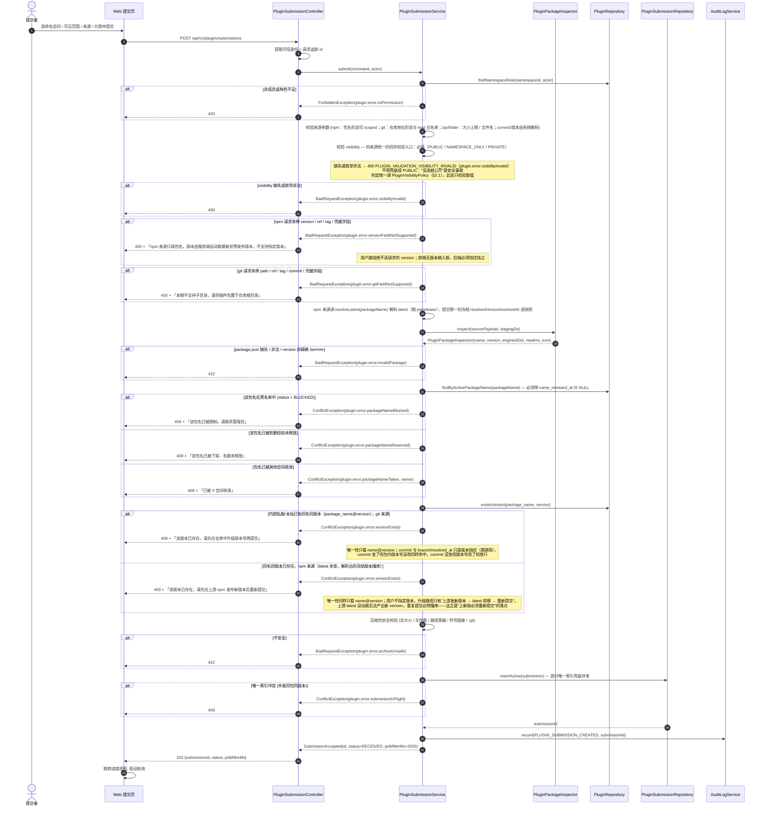

# §4.1–§4.2　提交同步校验路径、submission worker 全流程

> 所属：后端　｜　覆盖章节：§4.1–§4.2
> 章节号全局唯一、不随文件移动；跨文件引用写 `§N.M`，不要写文件名。索引见 [`../README.md`](../README.md)。

## 4. 关键链路时序

### 4.1 提交（同步校验路径）



同步阶段预算：P95 ≤ 300ms（zip ≤ 50 MiB 的解包 + `package.json` 解析 + 安全扫描路径名检查 + npm 一次 `resolveLatest` 元数据 GET）。**不做**：不下载 npm tarball、不克隆 Git、不调用 scanner、不写私服、不写索引。**npm 与 Git 的版本解析时机不同，别混为一谈**：npm 来源在这一步就必须调 `resolveLatest(packageName)` 取 latest 并**冻结版本**——因为 `plugin_submission.version` 在 insert 时即 NOT NULL，且 409 `versionExists` 是同步判定，版本不解析出来这两件事都做不了；这是一次轻量 registry 元数据 GET（不是 tarball 下载），带短超时 + 失败快速返回。Git 的默认分支与 commit 解析则放在异步阶段——`ls-remote` + 浅克隆是重网络调用，会破坏毫秒级预算；同步阶段只做**仓库地址形态与 host 白名单**的格式校验，以及"请求是否夹带 path/ref/tag/commit/凭据，或 npm 夹带 version/ref/tag/凭据等本期不支持字段"的检查（**不存在用户填的 ref/commit/version**）。

### 4.2 submission worker 全流程

```mermaid
sequenceDiagram
    autonumber
    participant SCH as @Scheduled (interval)
    participant WK as PluginSubmissionWorker
    participant Q as PluginSubmissionRepository
    participant M as PluginPackageMaterializer
    participant T as PluginTrustScanPort
    participant D as PluginScanDecision
    participant N as NpmRegistryPort
    participant DB as Domain Repositories
    participant I as PluginIndexService
    participant A as AuditLogService

    SCH->>WK: runOnce()
    WK->>Q: findDispatchable(now, batchSize) FOR UPDATE SKIP LOCKED
    Q-->>WK: submissions[]
    loop 每条 submission
        WK->>Q: claim(now, lease, owner)
        alt 已被其它副本认领
            WK-->>WK: skip
        end

        WK->>M: materialize(submission, stagingDir)
        Note over M: npm 按 submission 快照里已冻结的 resolvedVersion 下载 tarball 并校验 dist.integrity<br/>（绝不重新 resolveLatest：上游 latest 此刻可能已前移，但本提交只认冻结版本）<br/>git ls-remote 解析 commit 后浅克隆并导出；zip/folder 安全解包后规范化为 npm tarball
        M-->>WK: StagedPackage(tarballPath, sha512, metadata, readme, icon)

        WK->>WK: 复核包名/版本与 submission 一致
        alt 不一致 (来源被替换)
            WK->>Q: failTerminal(plugin.error.packageNameMismatch)
            Note over WK: npm 版本取自快照而非实时 latest；tarball 内 package.json 的 version<br/>必须与冻结版本一致，否则视为来源被替换 → 终态。终态直接处理下一条
        end

        WK->>WK: 校验包内声明的图标 (≤32 KiB; SVG/PNG/JPEG/WebP)
        alt 声明了图标但不合法
            WK->>Q: failTerminal(plugin.error.iconInvalid)
            Note over WK: 声明了就必须合格：静默丢弃会让作者以为上传成功<br/>未声明则直接无图标, 不报错
        end

        WK->>T: scan(tarball, name, version, spec)
        alt scanner 503 / 504 / 网络错误
            T-->>WK: PluginScanAdapterException(retryable)
            WK->>Q: retryLater(backoff, code)
            Note over WK,Q: 超过 maxAttempts 转 failTerminal(plugin.error.scanUnavailable)
        else 报告不可解析 / schemaVersion 未知
            T-->>WK: PluginScanAdapterException(nonRetryable)
            WK->>Q: failTerminal(plugin.error.scanInvalidReport)
            WK->>A: record(PLUGIN_SCAN_INVALID)
        else 正常报告
            T-->>WK: TrustCheckReport
            WK->>D: verdict(report)
            D-->>WK: RED | REVIEW | CLEAR | ERROR
        end

        WK->>DB: saveScanReport(submissionId, attemptNo, status, verdict, fingerprint)
        Note over WK,DB: 报告一律挂 submission（plugin_version_id 可空）<br/>红线与失败也有落点, 放行与追溯才有对象可绑

        alt verdict = ERROR (fail closed)
            WK->>Q: retryLater 或 failTerminal(plugin.error.scanFailed)
        else verdict = RED
            alt 该指纹已有有效放行
                WK->>A: record(PLUGIN_WAIVER_APPLIED)
                WK->>WK: 按 review/clear 继续
            else 无放行
                WK->>Q: toScanRed(reportId)
                WK->>A: record(PLUGIN_SCAN_RED)
                Note over WK: 不建版本 / 不写私服 / 不标脏索引<br/>等待管理员按指纹放行, 或作者改包重提
            end
        end

        alt verdict = REVIEW | CLEAR (或已放行)
            WK->>DB: upsertPlugin + insertVersion(status=SCAN_PASSED)
            alt 空间需审核
                WK->>DB: 建 review_task(PLUGIN_VERSION)
                WK->>Q: toReviewPending(pluginId, versionId)
                WK->>A: record(PLUGIN_VERSION_AWAITING_REVIEW)
                Note over WK: 版本停在 REVIEW_PENDING, 制品只在暂存区<br/>私服上什么都没有, 谁都装不到（§14.1 A11）
                WK-->>UI: 阶段「等待审核」
            else 空间免审
                WK->>Q: toPublishing(pluginId, versionId)
                WK->>N: publish(tarball, name, version)
                alt 代发可重试失败 (5xx / 网络)
                    WK->>Q: retryLater(backoff, plugin.error.registryPublishFailed)
                    Note over WK: 版本保持 PUBLISHING, 由本 worker 下轮重试
                else 代发不可重试 / 耗尽 (409 / 401 / 422)
                    WK->>DB: version 退回 SCAN_PASSED (待发布态)
                    WK->>Q: failTerminal(plugin.error.registryPublishFailed)
                    WK->>A: record(PLUGIN_PUBLISH_FAILED)
                else 代发成功
                    WK->>DB: 回填 report.plugin_version_id + publish_timestamp
                    WK->>DB: version LISTED
                    WK->>Q: toListed(pluginId, versionId)
                    WK->>I: markDirty()
                    WK->>A: record(PLUGIN_VERSION_LISTED)
                end
            end
        end
    end
```

关键不变量：
0. **npm 版本提交即冻结、全流程复用**：npm 来源的版本在提交那一刻由 `resolveLatest` 解析并冻结进 `plugin_submission.source_payload`（`resolvedVersion` + `resolvedAt`）；`materialize` 下载、`scan`、`publish`、`upsertVersion`、索引组装**全程读这一个冻结版本，任何阶段都不重新解析 latest**。理由：`latest` 会移动，若审核/代发时重解析，上游在提交后发了新版本就会导致"审的是 A、发的是 B"，破坏下面第 2 条 sha512 一致性与 §8.4 第 15 条"扫的就是发的"断言。上游后续发版不影响已上架版本；要上新版必须重新提交（重新解析一次 latest）。
1. **扫描在代发之前**：`NpmRegistryPort.publish` 只在 `verdict ∈ {REVIEW, CLEAR}`、或该指纹命中 `plugin_scan_waiver` 的有效放行时被调用。
2. **被扫字节 = 被发字节**：`materialize` 产出的 `tarballPath` 同时用于 `scan` 与 `publish`，`sha512` 落到 `plugin_version.sha512` 与 `plugin_scan_report.tarball_sha512`，两者不等即视为供应链绕过（生成期断言 + 告警）。
3. **红线留痕但不落版本**：`RED` 写一份 `SUCCESS + RED` 报告（挂 `plugin_submission_id`，`plugin_version_id` 为 NULL），提交转 `SCAN_RED`；**不建版本、不写私服、不标脏索引**。报告必须落库，否则放行与"当时为什么拦"都无对象可绑（这是对 R1 的修正）。
4. **闸门顺序固定为：扫描 → 审核（仅团队空间）→ 代发 → 上架**（用户第二次裁决，覆盖 v2.2 的"先代发后审核"）。审核人批的是**尚未推送的暂存包**，私服上此刻什么都没有；通过后代发才把制品推上去，代发成功才 `LISTED`。**这条顺序的代价换成了另一种**：审核通过后代发可能长期失败（网络/凭据/私服保留策略），版本停在 `APPROVED` 上不了架——审核结论不回滚、可重试，见 §4.6 与 §14.1 A11。
5. **报告归属以提交为准**：同一提交每次重扫新增一行（`(submission_id, attempt_no)` 唯一），版本只在代发+落库成功后回填 `plugin_version_id`；`plugin_version.scan_report_id` 指向最新一条。
6. **图标只取包内声明，且声明了就必须合格**：图标由 `package.json` 的 `dsh.icon`（或 `icon`）声明，指向包内相对路径；物化阶段校验"文件存在 + 读取字节 ≤ 32 KiB + 头部魔数属于 SVG/PNG/JPEG/WebP + SVG 不含 `<script`/`on*=`/外部 `xlink:href`"。不合法即 `VALIDATION_FAILED(plugin.error.iconInvalid)`。**不做站内上传入口**——v1 图标唯一来源是包内容，这样"索引里的图标"与"装到的包"永远同源，也省掉一套权限与存储路径。

图标校验的具体参数（handover 缺口 #3）：

| 项 | 取值 | 理由 |
|---|---|---|
| 大小上限 | 32 KiB（`32768` 字节） | DSH 端要缓存并渲染；32 KiB 足够 512×512 PNG 或带简单渐变的 SVG，超过多为误传了原图 |
| 允许类型 | SVG、PNG、JPEG、WebP（按**魔数**判定，不看扩展名） | 四类覆盖显式声明与常见导出；按魔数判定避免 `.svg` 里塞 PNG 这类"改名骗过校验" |
| SVG 附加限制 | 无 `<script`、无 `on*=` 事件属性、无外部引用（`http(s)://`、`xlink:href` 指向站外） | SVG 会被直接作为 `` 与索引资源分发，带脚本的 SVG 是最常见的存储型风险 |
| 非法时的行为 | `VALIDATION_FAILED` 终态 + `plugin.error.iconInvalid` + 具体原因（超限/类型/脚本） | 失败要可自修；只返回"图标非法"会让作者反复试 |
| 未声明时 | `icon_key` 留空，索引省略 `icon` 键，列表卡片用站内占位 | 不写 `null`、不写占位图 URL（见 §8.1） |
| 落盘键 | `dsh/icons/{pluginKey}.{svg\|png\|jpg\|webp}` | 与索引里 `icons/{pluginKey}.{ext}` 同构，`ext` 取实际字节类型 |

