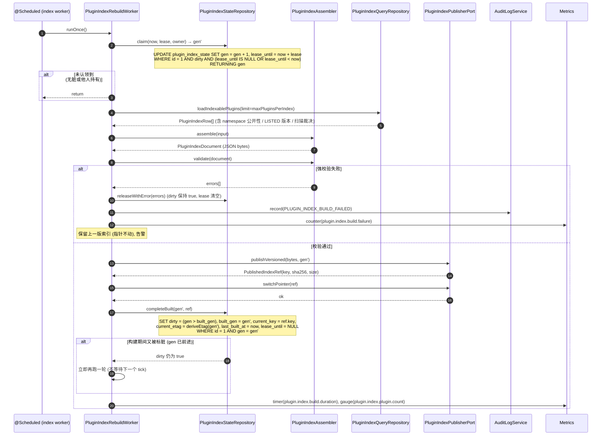

# §4.3–§4.5　索引重建与指针切换、索引读取与 304、安装文档渲染

> 所属：后端　｜　覆盖章节：§4.3–§4.5
> 章节号全局唯一、不随文件移动；跨文件引用写 `§N.M`，不要写文件名。索引见 [`../README.md`](../README.md)。

### 4.3 索引重建与指针切换



设计要点：
- **单行状态 + `gen` 自增**是抖动合并机制：N 次状态变化只产出 1 份索引（第二次循环读到的就是最新数据）。
- **没有 ShedLock**：`UPDATE ... WHERE dirty AND lease 过期 RETURNING` 在单行上天然互斥，多副本安全。
- **失败不推进指针**：可用性优先（PRD §8.6），`current_key` 保持上一版，DSH 继续拿到旧索引而不是 5xx。
- `dirty` 的置位点：版本/插件状态变化、分类修改、下架/恢复、放行、重扫结论变化、图标更新。全部走同一 `PluginIndexService.markDirty()`，**不订阅进程内事件**（多副本下不可靠）。

### 4.4 `/dsh/index.json` 读取与 304

```mermaid
sequenceDiagram
    autonumber
    participant DSH as DSH 客户端
    participant NG as nginx
    participant C as PluginIndexController
    participant RC as PluginIndexReadCache
    participant PUB as PluginIndexPublisherPort
    participant MOD as PluginMarketService

    DSH->>NG: GET /dsh/index.json (无 Cookie)
    NG->>C: proxy_pass (location ^~ /dsh/)
    C->>C: 校验 market enabled (关闭时返回 503, 不重定向)
    C->>MOD: currentIndexEtag() → gen, etag
    alt 请求头 If-None-Match == etag
        C-->>DSH: 304 Not Modified (带 Cache-Control / ETag)
    end

    C->>RC: get()
    alt 缓存命中且未过期 (ttl 60s)
        RC-->>C: bytes + etag
    else 缓存过期
        C->>PUB: readPointer()
        alt 指针 gen 与缓存一致
            C->>RC: refreshTtl() (1 次小对象 GET, 不重读正文)
            RC-->>C: bytes + etag
        else 指针 gen 变化
            C->>PUB: readVersioned(pointer.key)
            PUB-->>C: bytes
            C->>RC: put(bytes, etag=deriveEtag(gen))
            RC-->>C: bytes + etag
        end
    end

    C-->>DSH: 200 application/json; charset=utf-8<br/>Cache-Control: public, max-age=60<br/>ETag: &quot;dsh-gen-{gen}&quot;<br/>X-Content-Type-Options: nosniff
```

硬约束（`PRD §8.6`）逐条落到实现：

| 要求 | 实现 |
|---|---|
| `GET` 返回 2xx | 只有 200 / 304 / 503（市场关闭）/ 404（指针缺失，首次部署前） |
| **禁止重定向** | Controller 直接 `ResponseEntity`，永不返回 3xx；nginx 的 `^~` 前缀避免任何 rewrite |
| 匿名可读 | 该路径不进 Spring Security 的认证链（permitAll），不读会话、不读 Cookie |
| UTF-8 JSON | `Content-Type: application/json; charset=utf-8`，字节为 `UTF_8` 编码的 `byte[]`，不经消息转换器二次编码 |
| ≤ 128 MiB | 生成期硬上限（`maxIndexBytes = 32 MiB`），超限即构建失败并告警 |
| `Cache-Control` + `ETag` | `public, max-age=60` + 强 ETag `"dsh-gen-{gen}"` |
| 子路径 | 所有绝对 URL 由 `PluginPublicUrlBuilder` 用 `skillhub.public.base-url` + `SKILLHUB_WEB_BASE_PATH` 拼；索引中的 `icon` 是相对路径（`icons/{key}.svg`） |
| 不因登录态/审核故障 5xx | 读路径只读对象存储 + 内存缓存，不查库、不查审核队列 |

### 4.5 安装文档渲染

```mermaid
sequenceDiagram
    autonumber
    participant AG as Agent
    participant NG as nginx
    participant C as PluginIndexController
    participant Q as PluginQueryService
    participant R as PluginRepository
    participant S as PluginScanSummaryService
    participant URL as PluginPublicUrlBuilder

    AG->>NG: GET /dsh/install/{ns}/{slug}/{version}.md
    NG->>C: proxy_pass
    C->>Q: findPublicInstallTarget(ns, slug, version?)
    Q->>R: findByNamespaceSlugAndStatus(ns, slug, LISTED)
    alt 不存在 / 私有空间 / 未上架
        C-->>AG: 404 (text/markdown, 统一文案, 不泄漏存在性)
    end
    R-->>Q: plugin + versionList + enginesDsh + source
    alt URL 带 {version}
        Q->>Q: 取该精确版本 (必须属于本插件且 status=LISTED)
        alt 版本不存在或未上架
            C-->>AG: 404 (同一文案)
        end
    else URL 不带版本 (旧路径别名)
        Q->>Q: 取最新 LISTED 版本
        Note over Q: 不 302, 直接 200 返回最新内容<br/>避免违反"索引路径禁止重定向"的硬约束
    end
    Q->>S: latestSucceededReport(versionId)
    S-->>Q: 裁决 + capabilities + redLineCodes + toolVersion + scannedAt
    Q->>URL: installDocUrl(ns, slug, version)
    URL-->>Q: 绝对 URL (含 base path)
    C-->>AG: 200 text/markdown; charset=utf-8<br/>Cache-Control: public, max-age=60

    Note over C: 实时渲染, 不物化<br/>文档内不含任何 Token / registry 凭据
```

**路径有两种形态**：`/dsh/install/{ns}/{slug}/{version}.md`（精确版本，**详情页那一条安装提示词指向的就是它**——全站只有这一个复制入口，见 §7.2 与 §10.2）与 `/dsh/install/{ns}/{slug}.md`（旧路径，等价于"最新 `LISTED` 版本"，直接 200 返回而不是 302）。二者内容都实时渲染，不物化——物化会引入第二份需要重建的产物，且重建失败时会出现"索引指向 A 版本、文档说 B 版本"的不一致；单一路径也无法表达多版本（这正是 R3 的修法）。

安装文档的分段、标题与顺序**以 `PRD §5.3` 的 7 段模板为准**（段数从 6 调整为 7，本设计不再复述整份模板）。以下是取值规则必须由设计决定的三段，按**段名**对应，不按序号——避免 PRD 调整段序时这里跟着错：
- 「需要安装的内容」段：`name@version`、`engines.dsh`、来源（npm registry 或 git url + 提交号）。
- 「安装命令」段：固定 `dsh plugin --profile <profile> add {name}@{version} --ignore-scripts`，版本段必须与路径里的 `{version}` 一致（"复制哪个版本就装哪个版本"）。
- 「能力披露」段：只写**能力 code + 中文固定文案 + 一行"未检出≠安全"**，不复制整份证据（证据只在站内详情页）。
- `index.md` 用同模板，列出前 50 个插件（超出指向站点 URL）。

版本解析规则：带版本段 → 精确匹配且必须是 `LISTED`；不带版本段 → 最新 `LISTED`。两者都走同一段模板，只有"精确版本"那一行不同。文档对同一 `(slug, version)` 的内容是确定的，因此可以放心给 `max-age=60`。

**`YANKED` / 未上架版本的安装文档一律 404，且不得重定向（本次补，`PRD §5.2` v2.15）**：某个版本被撤版（`YANKED`）后，`/dsh/install/{ns}/{slug}/{version}.md` 必须返回 **404**（与"版本不存在"同一文案，不泄漏"这个版本曾经存在"）；**严禁 301/302 到最新版本**。原因有两层：① `/dsh/*` 的硬约束本来就是"禁止重定向"（`DSH` 客户端会把 30x 当成索引源异常）；② 更实质的是**装错版本**——用户手上那份提示词写着 `1.0.0`，重定向到 `1.1.0` 就等于让他装了一个没被这份提示词承诺过的版本，"复制哪个版本就装哪个版本"的验收口径当场失效。无版本别名 `/dsh/install/{ns}/{slug}.md` 仍解析到当前最新 `LISTED` 版本（这是它本来的语义，不是重定向），撤空后同样 404。

