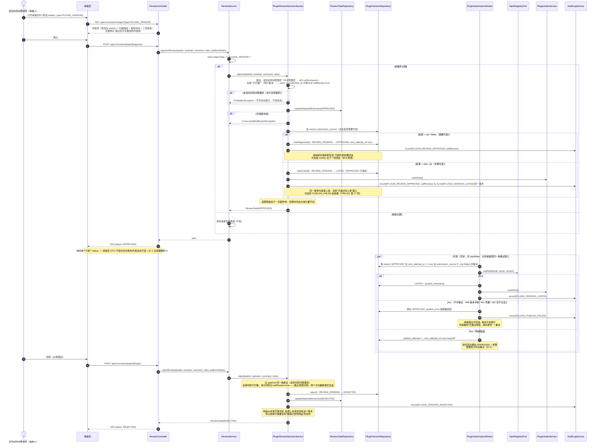

# §4.6–§4.7　审核链路（通过才代发）、审核人浏览暂存包内文件

> 所属：后端　｜　覆盖章节：§4.6–§4.7
> 章节号全局唯一、不随文件移动；跨文件引用写 `§N.M`，不要写文件名。索引见 [`../README.md`](../README.md)。

### 4.6 审核（PLUGIN_VERSION）→ 通过才代发，拒绝即终态（无撤包动作）



**为什么必须独立服务**：`ReviewService.approveCheckedTask` 在 `SKILL_METADATA` 以外无条件 `skillVersionRepository.findById(...)`，随后读 `Skill`、检查同 slug 冲突、更新 `Skill` 的 `latestVersionId`。PLUGIN_VERSION 若走这条路径，`getSkillVersionId()` 为 null，第一步就抛 `DomainNotFoundException("skill_version.not_found")`；即便绕过，也会把插件版本当成技能版本发布。因此在 `ReviewService` 的两个入口加显式分流（而不是静默落空），是本变更对既有代码的唯一侵入点。

**审核页必须展示的字段**（审核人批的是**尚未推送的暂存包**，不是线上制品）：

| 字段 | 来源 | 为什么要给审核人看 |
|---|---|---|
| 暂存包 `sha512` | `plugin_version.sha512` | 与扫描报告里的 `tarball_sha512` 对得上，才能证明"批准的就是被扫的那份"；页面上写清「这是暂存包指纹，该版本尚未上架」 |
| 扫描指纹 + 工具版本 + 扫描时间 | `plugin_scan_report` | 报告可能已过时数天（§14.1 A12），审核人要能看到新鲜度 |
| 裁决与能力/红线摘要 | `plugin_scan_report` | 与详情页口径一致，不另做一套文案 |
| 版本与包名 | `plugin_version` | 批准后就会以这个版本上架，版本号写错等于发错东西；**npm 来源此处显示的是提交时冻结的版本**（`plugin_submission.source_payload.resolvedVersion`），不是审核当下的 registry latest——审核人批的就是这份冻结版本对应的暂存包 |
| **上架状态说明（固定文案）** | 常量，不入 DTO | 审核页常驻一行「该版本尚未上架，通过后才会进入插件市场与索引」（`PRD §6.5` v2.15 原文，四语言齐平）。**审核页 DTO 不得下发任何发布/代发状态字段**（`publishState` / `published` / `publishAttempt` / `publishError` / `nextAttemptAt` 一律不出现）——审核人不需要知道、也不该被引导去关心平台内部何时推送；他能看到的是"上架 / 未上架"这一个二元口径（§7.2 五条硬规则 1、§16 S20） |
| 包内文件清单与单文件内容（只读） | `plugin_submission.staged_tarball_key` 指向的暂存 tarball（§4.7） | 扫描结论说的是"工具检测到了什么"，审核人要自己确认 `scripts`、`dsh.bundle` 声明、有没有把 `.env`/`.npmrc` 打进包；内容**只读不执行**，且与 sha512 同一份字节（§7.6） |

**审核通过但发布失败**（新链路的唯一代价，**只在 zip/folder 上成立**——npm/git 审核通过即上架，走不到这里；`PRD §11` 第 17 项原文："npm 与 Git 来源不经这一步，审核通过即上架"）：

| 视角 | 表现 |
|---|---|
| 版本状态 | 停在 `APPROVED`（免审空间退回 `SCAN_PASSED`）；**审核结论不回滚**——不需要重新审一遍 |
| 索引与可见性 | 不进索引；详情页与安装文档对任何人都是 404（还没有可安装产物，不是"无权"）；成员在后台能看到失败原因 |
| 作者（「我的插件」→ 在途提交） | 阶段显示「已通过审核，等待发布」+ 脱敏原因（`plugin.error.registryPublishFailed`）+ 剩余重试次数 + 「重试发布」按钮；不要求改包（包本身没问题） |
| 管理员 | 插件治理页可对单版本发起「重试发布」（`POST .../versions/{v}/publish {action: RETRY}`）；连续失败达阈值（`publish_attempt >= 5` 或同一 `name` 24h 内失败 ≥3 次）触发 P1 告警，附 `name@version` 与最后一次错误码 |
| 恢复路径 | 修私服凭据/保留策略 → 手动重试或等自动退避重试 → 成功即 `LISTED` + `markDirty`，全程不重走扫描与审核 |
| 重试/代发时的版本（npm） | 重试与代发**始终用提交时冻结的 `resolvedVersion`**，不重新解析 latest——即使上游此刻发了新版本，也不会把"审过的 A"换成"没审过的 B"；"扫的就是发的"对比基准就是这份冻结版本 + 其 sha512（§4.2 第 0/2 条、§8.4 第 15 条） |
| 不许做的事 | 不许把它降级成"审核通过即可见"（索引里没有制品，DSH 装上会 404）；也不许静默丢弃——静默等于作者永远等不到结果 |

### 4.7 审核人浏览暂存包内文件（只读预览）

审核人要判断"这个包会不会乱来"，只看 sha512 与扫描结论是不够的——扫描器说的是"它检测到了什么"，审核人要自己看一眼 `package.json` 的 `scripts`、看 `dsh.bundle` 指向哪些文件、看有没有把 `.npmrc` 打进包里。所以审核页必须有**只读**的文件浏览。但预览是最危险的一个面：它把**未经审核的第三方内容**搬到我们自己的域名下渲染。整条链路按"内容永远不进浏览器执行上下文"设计。

```mermaid
sequenceDiagram
    autonumber
    actor RV as 空间管理员 / 提交者本人
    participant UI as 审核页 PluginFileBrowser
    participant FC as PluginSubmissionFileController
    participant FS as PluginStagedFileService
    participant Q as PluginSubmissionRepository
    participant C as PluginStagedFileIndexCache
    participant AR as PluginArchiveReaderPort
    participant ST as 对象存储（暂存 tarball）
    participant A as AuditLogService

    RV->>UI: 展开「包内文件（只读）」
    UI->>FC: GET /api/v1/plugins/submissions/{id}/files
    FC->>FS: list(submissionId, actor, requestId)
    FS->>Q: findById(submissionId)
    alt 提交不存在
        FS-->>FC: NotFound(plugin.error.stagedSubmissionNotFound)
        FC-->>UI: 404
    end
    FS->>FS: assertVisible(submission, actor)
    alt 既非该空间的空间管理员（空间 ADMIN），也非提交者本人
        FS-->>FC: Forbidden(plugin.error.noPermission)
        FC-->>UI: 403
        Note over FS: 平台管理员（SKILL_ADMIN / SUPER_ADMIN）**不在其列**：<br/>`PRD §9` 矩阵「审核插件版本（团队空间）」一行是<br/>访客—/空间成员—/空间管理员✓/平台管理员—，<br/>他们看证据走「查看完整扫描报告与证据」那一行，<br/>与包内文件浏览是两件事（§7.6.6）
    end
    FS->>FS: resolveArchive(submission)
    alt staged_tarball_key 为空（已按保留策略清理）或对象不存在
        FS-->>FC: Gone(plugin.error.stagedPackagePurged)
        FC-->>UI: 410 + 「包内容已按保留策略清理」
    end
    FS->>C: get(submissionId, sha512)
    alt 缓存命中（键 = submissionId + tarball sha512）
        C-->>FS: StagedFileListing
    else 未命中
        FS->>ST: get(staged_tarball_key)
        ST-->>FS: tarball bytes
        FS->>AR: readIndex(tarball, limits)
        Note over AR: tgz 是 gzip 流，**没有随机访问**：<br/>读清单必须从头解压遍历整条流一次（但不落盘、不留内容）。<br/>任一上限命中即抛，不产出"半份清单"
        AR-->>FS: StagedFileListing(entries, totalBytes)
        FS->>C: put(submissionId, sha512, listing)
    end
    FS->>A: record(PLUGIN_SUBMISSION_FILES_VIEWED, id, entryCount, result)
    FS-->>FC: StagedFileListing
    FC-->>UI: 200 application/json（清单 + sha512 + 生效上限）

    RV->>UI: 点开一个文件
    UI->>FC: GET .../files/content?path=package.json
    FC->>FS: readText(id, path, actor, requestId)
    FS->>FS: 白名单精确比对：path 必须与清单某项**逐字节相等**（大小写敏感）
    alt 未命中白名单
        FS-->>FC: NotFound(plugin.error.stagedFileNotFound)
        FC-->>UI: 404
    end
    FS->>ST: get(staged_tarball_key)
    FS->>AR: readEntry(tarball, entry, limits)
    Note over AR: 从流头顺序解压到目标条目即停，<br/>累计解压字节受 budget 约束
    AR-->>FS: StagedEntryBytes
    FS->>FS: 一致性复核：整包 sha512 == 库值，不等即 409 + 告警
    FS->>FS: detectBinary(head, path)
    alt 判定为二进制
        FS->>A: record(PLUGIN_SUBMISSION_FILE_VIEWED, path, size, result=binary)
        FS-->>FC: StagedFileBinaryMeta（类型 + 大小 + 魔数，**不含字节**）
        FC-->>UI: 200 application/json
    else 文本
        FS->>A: record(PLUGIN_SUBMISSION_FILE_VIEWED, path, size, durationMs)
        FS-->>FC: StagedTextFile
        FC-->>UI: 200 text/plain; charset=utf-8<br/>X-Content-Type-Options: nosniff<br/>Content-Security-Policy: default-src 'none'; sandbox<br/>Cache-Control: no-store
        UI->>UI: 以文本节点渲染（pre + textContent）<br/>禁止 innerHTML / dangerouslySetInnerHTML / iframe
    end
```

这条链路的五条不变量（每一条都进 §16 的回归断言）：

1. **数据源唯一**：只读 `plugin_submission.staged_tarball_key` 指向的那份字节。审核发生在代发之前，私服里没有这个包；**任何情况下都不许回退**去私服或上游 npm 拉同名同版本（那会变成"审 A 看 B"，比不给看更糟）。暂存包被清理后返回 `410 stagedPackagePurged`，并在页面上直说"已按保留策略清理"。
2. **同一份字节**：清单里的 `sha512` 来自 `plugin_submission.tarball_sha512`（物化阶段写死），读取前后各比一次；不一致即 `409 stagedPackageMismatch` + P1 告警。这是 §14.1 A13 在预览面上的延伸——预览与代发必须对着同一份字节。
3. **内容不进渲染上下文**：响应类型只有 `text/plain` 与 `application/json` 两种；前端只用文本节点。**不允许**把包内 `.html` / `.svg` / `.js` 当可渲染类型返回，也不允许用 `<iframe src>` 指向包内文件——那等于给未审核内容一个同源执行环境。
4. **tgz 没有随机访问，所以必须缓存**：暂存包是 npm tarball（`.tgz`，gzip 流），不是 zip，"只解一次索引、之后按偏移随机读"在物理上做不到。可交付的保证是：**同一 `(submissionId, sha512)` 在一次缓存有效期内只完整遍历一次**；缓存按 `(submissionId, sha512)` 双键失效（sha512 变即视为新对象），单文件读取仍从头解压到目标条目，但受 `budget` 与单文件上限约束。缓存放进程内（与 `PluginIndexReadCache` 同构，多副本各存一份），不落库、不写对象存储——审核流量是"每天几十次"，不值得为它加一张表。
5. **高危操作必须留痕且失败即拒**：清单浏览、单文件查看、下载三类动作各写一条审计（字段见 §7.6）。审计写不进去时**不返回内容**（fail closed，503 `plugin.error.fileBrowseDisabled` 同类语义）——一个查不到"谁看了什么"的预览面，不该存在。

上限数值、路径穿越三层防护、二进制判定规则、审计字段与限流值统一写在 §7.6，本节不重复。

---

