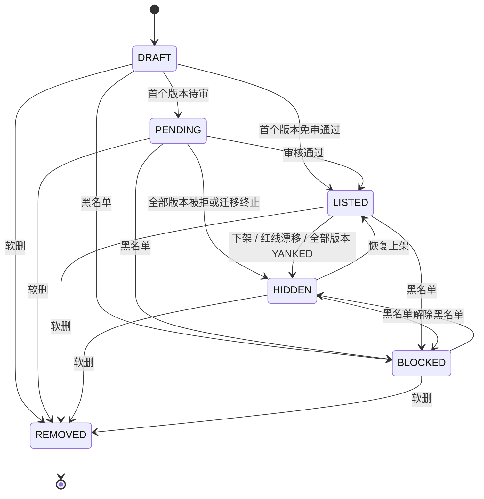
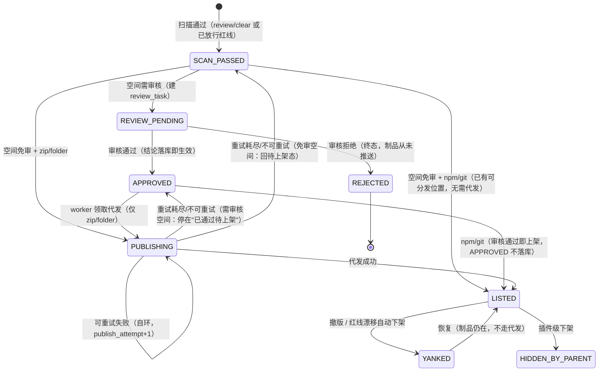
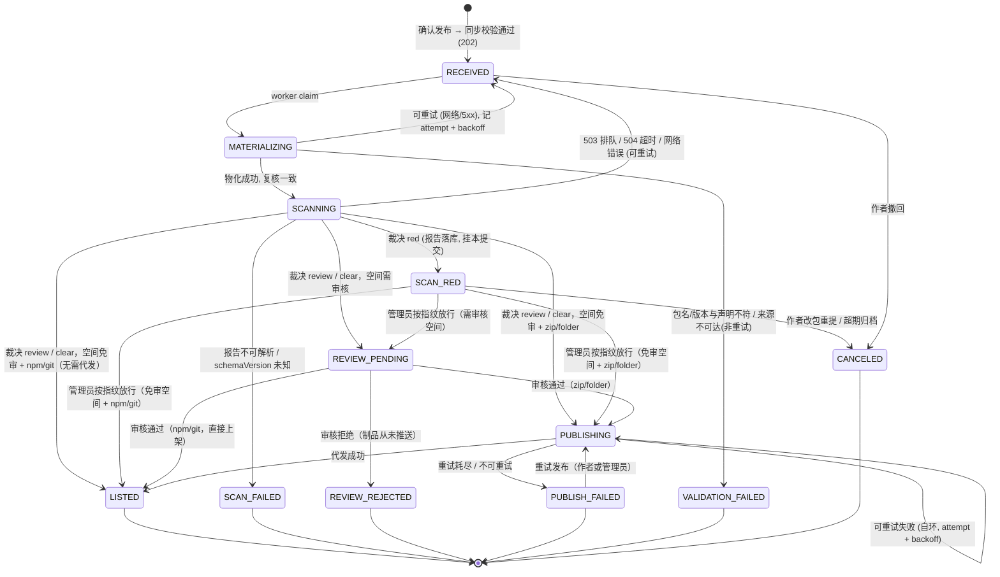
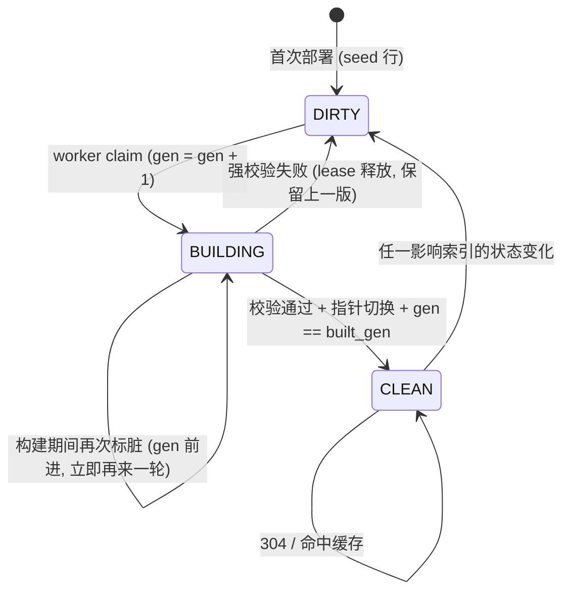

# §5　版本状态机、提交状态机、不可达边与不变量

> 所属：后端　｜　覆盖章节：§5
> 章节号全局唯一、不随文件移动；跨文件引用写 `§N.M`，不要写文件名。索引见 [`../README.md`](../README.md)。

## 5. 状态机

### 5.1 `plugin`（目录实体）

> `REMOVED` 是终态：不提供"取消软删"（要复活就重提并重新走扫描/审核，包名需先释放）。`BLOCKED` 与 `REMOVED` 是两条互不替代的路径——黑名单拦"同名包再进来"，软删只处理"这一个插件不再对外"，所以黑名单的插件软删后仍然 `package_name` 占位、后续提交继续 409。
>
> **释放包名不是状态迁移**：它只写 `name_released_at`，`status` 保持 `REMOVED`。可以让包名重新被占用的唯一动作，只有"释放"；软删、黑名单都不释放。

| 事件 | 前置条件 | 副作用 | 审计 |
|---|---|---|---|
| 创建（版本落库时） | 无存量 `package_name`，且该包名不在黑名单 | `status=DRAFT`，写 `latest_version_id` | `PLUGIN_CREATED` |
| 转 PENDING | 空间发布策略要求审核 | — | — |
| 转 LISTED | 存在 `LISTED` 版本且私有空间判定为公开 | `latest_scan_verdict` 随版本更新；`markDirty` | `PLUGIN_LISTED` |
| 下架 HIDDEN | 空间 ADMIN / `SKILL_ADMIN` / `SUPER_ADMIN` | `markDirty`；索引下一轮剔除 | `PLUGIN_HIDDEN`（含 reasonCode） |
| 恢复 LISTED | 同上，且**至少一个 `LISTED` 版本**（撤空后不允许直接恢复）、最新裁决非 red（除非指纹已放行） | `markDirty` | `PLUGIN_RESTORED` |
| **黑名单 BLOCKED** | 仅 `SUPER_ADMIN`；必填理由 | **一个事务里同时成立三件事**：① 状态置 `BLOCKED`（等价即刻下架）→ 详情页、安装文档、图标、`/dsh/*` 上该插件**全部路径立即 404**；② `markDirty` → 下一轮索引重建剔除（端到端 ≤2 分钟，§8.3）；③ 该 `package_name` 的后续提交在同步校验即 409 `packageNameBlocked`。**存量 tarball 不删除**（保留取证），但永不再进入索引。三件事的成败与理由同一次写审计 | `PLUGIN_BLOCKED`（理由 + 影响版本清单 + 三件事的结果码） |
| 解除黑名单 | 仅 `SUPER_ADMIN`；必填理由 | 清空 `blocked_*`，状态回落 `HIDDEN`（**不自动恢复上架**，需再走一次"恢复上架"，避免误解除直接对外） | `PLUGIN_UNBLOCKED` |
| 软删 REMOVED | **空间 `ADMIN` + 平台管理员（`SKILL_ADMIN` / `SUPER_ADMIN`）**（`PRD §9` 矩阵；已裁决，非建议值）；必填理由 | 写 `removed_at/removed_by/remove_reason`；保留 tarball 与报告；`markDirty`；详情页与安装文档立即 404，索引下一轮剔除；**`package_name` 不自动释放**，该包名后续提交在同步校验返回 409 `plugin.error.packageNameReserved` | `PLUGIN_REMOVED`（理由 + 影响版本清单） |
| 释放包名（墓碑化） | 仅 `SUPER_ADMIN`；前置 `status='REMOVED'`（必须先软删，避免"还挂着却已释放"） | 写 `name_released_at/name_released_by`；此后 `package_name` 与 `(namespace_id, slug)` 都不再参与唯一性，可被新提交占用；旧行保留为墓碑（对任何用户可见入口不可见）；**idempotent**：重复调用不改首次 `name_released_at`，直接返回 200 | `PLUGIN_NAME_RELEASED`（含原 `package_name`、释放后首个占用者提交 ID，可为空） |

### 5.2 `plugin_version`

> `HIDDEN_BY_PARENT` 不是枚举值：插件下架时版本状态保持 `LISTED`，由 `plugin.status` 参与索引过滤（`PluginVersion.isIndexable()` 同时看自身与父状态）。上图该节点仅表示"逻辑上不可见"。
>
> **枚举 7 个值，一个不增不减**（按"扫描 → 审核 → 代发 → 上架"重排，用户第二次裁决）：`SCAN_PASSED`（扫描通过、待审或待上架）、`REVIEW_PENDING`（等待审核，**制品只在暂存区**）、`APPROVED`（审核通过、待上架；免审空间不出现此态）、`PUBLISHING`（代发中、可重试；**只有 zip/folder 可达**）、`LISTED`（已上架）、`REJECTED`（审核拒绝，终态）、`YANKED`（人工撤下）。
>
> **链路按来源分流（`PRD §6.2` v2.15 原文，用户裁决）：`PUBLISHING` 不是所有来源都会经过**——
> - **`submission_source ∈ {zip, folder}`**：这两种上传内容原本不在任何可分发的源上，平台必须先把它规范化成 npm 包、推送到内部源，才能进索引被 `dsh plugin add` 装到。所以它们走 `SCAN_PASSED`/`APPROVED` → `PUBLISHING` → `LISTED`，失败落 `PUBLISH_FAILED`。
> - **`submission_source ∈ {npm, git}`**：npm 的包本来就在源上（提交时冻结的 `name@version` 可直接按 registry 地址分发），Git 按仓库地址 + 提交号分发。**两者都不需要代发**，所以 `SCAN_PASSED`/`APPROVED` → **直接 `LISTED`**，**永不出现 `PUBLISHING`，也永不落 `PUBLISH_FAILED`**。
> - **状态枚举不增不减，只收窄可达性**：`PUBLISHING` / `PUBLISH_FAILED` 仍保留在枚举与 CHECK 约束里（DB 里有历史含义、运维查"为什么没上架"时要能区分"从没排过队"与"排过队但失败"），但生成路径只有上传型来源。**不要再为 npm/git 造 `LISTED_DIRECT` 之类的新值**——那会让"上架"这一件事有两个状态名，索引与审计要写两套判断。
> - **`APPROVED` 对 npm/git 是过路态、不落库**：审核通过时在同一事务内继续置 `LISTED`（写 `publish_timestamp` + `markDirty` + `PLUGIN_VERSION_LISTED` 审计）。刻意不持久化 `APPROVED`，是为了不触发约束 `ck_plugin_version_publish_retry_coherence`（它要求 `status='APPROVED'` 时 `next_attempt_at IS NOT NULL`）——一个"待代发但永远不会被 worker 领走"的行会让队列谓词与告警长期误报。
>
> **无孤儿态自检**（每个态都有入边、每个终态可达）：`SCAN_PASSED` ← 起点 + `PUBLISHING` 免审失败回退；`REVIEW_PENDING` ← `SCAN_PASSED`；`APPROVED` ← `REVIEW_PENDING` 通过 + `PUBLISHING` 需审空间失败回退；`PUBLISHING` ← `SCAN_PASSED`（免审 zip/folder）/ `APPROVED`（zip/folder）/ 自身重试自环 / 手动重试；`LISTED` ← `PUBLISHING` 成功（zip/folder）+ **`SCAN_PASSED` 免审直上（npm/git）+ `APPROVED` 审核通过直上（npm/git）** + `YANKED` 恢复；`REJECTED` ← `REVIEW_PENDING` 拒绝（终态）；`YANKED` ← `LISTED` 撤版。
>
> **`PUBLISHED` 已删除**：它原本表示"已代发但未上架"，这个语义在新链路上不存在——代发成功即 `LISTED`（`markDirty` 与代发在同一轮），代发失败就停在 `APPROVED`/`SCAN_PASSED`。删掉它还有一个好处：再也不会出现"私服上已经有、本站说没有"的中间态。
>
> **`APPROVED` 的重试是"回到自己"而不是"回到审核"**：`PUBLISHING → APPROVED` 不是回滚审核结论，只是把"待代发"这件事重新挂回队列；`review_task` 已结案，不会重新出现在审核队列里（重复审同一份产物没有意义）。
>
> **闸门顺序（用户第二次裁决，覆盖 v2.2）**：扫描 → **审核（仅团队空间）** → 代发 → 上架。理由：审核不该发生在产物已经被推到可安装的位置之后。**这条顺序的代价换了个方向**——审核通过后代发可能长期失败（凭据/保留策略/网络），版本停在 `APPROVED` 上不了架；但它不再是"审核期包已可安装"（那个风险随 `PUBLISHED` 一起消失），而是"审核通过却上不了架"，见 §14.1 A11 与 §4.6 附表。**注意"代发"这一步只对 zip/folder 存在**（见上一条）：npm/git 的链路是"扫描 → 审核（如需）→ 上架"，A11 那条风险对它们**不成立**——这也正是 `PRD §13` R7/R9 只谈"上传型来源"的原因。
>
> **拒绝不需要撤包**：`REJECTED` 时制品从未离开暂存区，私服上本来就没有 `name@version`，因此不存在"撤销已发布制品"的动作。原因：**审核发生在代发之前**，没有可撤的制品。v2.2 的 `revoke_state` 五态、撤销 worker、人工清理出口等**已删除，勿恢复**。

| 事件 | 前置条件 | 副作用 | 审计 |
|---|---|---|---|
| 落库为 SCAN_PASSED | 扫描 `review`/`clear`/已放行 red（**两个空间都一样**） | 版本行；**制品留在暂存区**；不进索引 | `PLUGIN_VERSION_CREATED` |
| 转 REVIEW_PENDING | 空间**需审核** | 建 `review_task(PLUGIN_VERSION)`；通知审核人；**私服无该版本** | `PLUGIN_VERSION_AWAITING_REVIEW` |
| 免审直接 PUBLISHING | 空间**免审** 且来源 `zip`/`folder` | 进代发队列 | `PLUGIN_VERSION_PUBLISH_SCHEDULED` |
| 免审直接 LISTED（npm/git） | 空间**免审** 且来源 `npm`/`git` | 同一事务内置 `LISTED` + `publish_timestamp=now` + `markDirty`；**不写 `next_attempt_at`、不进代发队列、不出现 `PUBLISHING`** | `PLUGIN_VERSION_LISTED`（detailJson 带 `sourceType`，用于区分"代发成功"与"本就无需代发"两类上架） |
| 审核通过 → APPROVED | 版本 `REVIEW_PENDING`、任务 pending，来源 `zip`/`folder` | `APPROVED` 且 **`next_attempt_at = now`**（不设这一列会被队列谓词过滤掉）；review_task 结案；worker 下一轮领走代发；**审核结论不回滚** | `PLUGIN_REVIEW_APPROVED` |
| 审核通过 → 直接 LISTED（npm/git） | 版本 `REVIEW_PENDING`、任务 pending，来源 `npm`/`git` | review_task 结案；**同一事务内**置 `LISTED` + `publish_timestamp=now` + `markDirty`；**`APPROVED` 不落库**、不排代发 | `PLUGIN_REVIEW_APPROVED` + `PLUGIN_VERSION_LISTED`（同一事务两条） |
| 审核拒绝 → REJECTED | 版本 `REVIEW_PENDING`、任务 pending | `REJECTED`（终态）；review_task 结案；暂存包按保留策略清理；**无撤包动作** | `PLUGIN_VERSION_REJECTED`（含 reviewer / comment） |
| 代发重试 | 私服 5xx / 连接失败 | `publish_attempt++`；`next_attempt_at=now+backoff`；自环等待 | `PLUGIN_PUBLISH_RETRY`（warning 级） |
| 代发成功 → LISTED | 私服返回 2xx | `publish_timestamp=now`；`LISTED`；`markDirty` | `PLUGIN_VERSION_LISTED` |
| 代发失败（需审核空间） | 4xx 不可重试，或 `publish_attempt >= maxAttempts` | 停在 `APPROVED`；`publish_error` 落脱敏原因；提交侧记 `PUBLISH_FAILED`；**审核结论保留** | `PLUGIN_PUBLISH_FAILED` |
| 代发失败（免审空间） | 同上 | 退回 `SCAN_PASSED`；提交侧记 `PUBLISH_FAILED` | `PLUGIN_PUBLISH_FAILED` |
| 手动重试发布 | 管理员（`SKILL_ADMIN`/`SUPER_ADMIN`）或作者，版本 ∈ {`APPROVED`, `SCAN_PASSED`} 且父插件未上架；幂等（重复调用不改首次审计） | `publish_attempt` 清零、`next_attempt_at=now`，回队列 | `PLUGIN_VERSION_PUBLISH_RETRIED` |
| 撤版 YANKED | 空间 ADMIN / 作者 / 管理员；`status='LISTED'`；幂等 | 从索引移除（下一轮）；tarball 保留；若撤掉的是最后一个 `LISTED` 版本 → 父插件置 `HIDDEN`（**不允许"已上架但无可安装版本"**）、`latest_version_id` 回填剩余最高 LISTED 版本（无则 NULL）、`markDirty`；作者在「我的插件」看到「已无可安装版本」，恢复上架必须先有至少一个可上架版本 | `PLUGIN_VERSION_YANKED` |
| 恢复版本 LISTED | 同上；`status='YANKED'`；最近成功报告裁决非 red（或已按指纹放行）；私服仍可取到制品（否则 409 `publishArtifactMissing`）；幂等 | 直接 `LISTED`（**不走代发**：制品没被删，重复 publish 同版本会被私服拒），父插件若为 `HIDDEN` 需再走"恢复上架"；`markDirty` | `PLUGIN_VERSION_UNYANKED` |
| 自动下架 | 升级重扫后 `clear→red` 且指纹未放行；或**撤销放行**后该版本变为未放行 red | 父插件置 `HIDDEN`；`markDirty`；告警；**同一次审计内**站内通知作者与该次放行的判定人（不新增通知通道） | `PLUGIN_AUTO_HIDDEN_SCAN_DRIFT` / `PLUGIN_WAIVER_REVOKED` |

**"已通过/待上架"三态（`SCAN_PASSED` 未审、`APPROVED` 待上架、`PUBLISHING` 上架中）的可见性**（产品裁决 + 新链路补充）：三者都**没有可安装制品**，对非成员一律按"未上架"处理——详情页 404、安装文档 404、不进索引；空间成员与作者在「我的插件」/空间插件 tab 可见，能看到当前阶段、失败原因（`publish_error`）、`publish_attempt` 与「重试发布」入口。理由：非成员看到它没有任何可行动作，只会误以为市场里有个坏插件；而作者必须看得见"卡在哪一步"。**这三个态只对 `zip`/`folder` 存在**：npm/git 版本从扫描通过（或审核通过）那一刻起就是 `LISTED`，不存在"已通过但没上架"的窗口，作者也不会看到"等待发布"。

### 5.3 `plugin_submission`

**入口前的用户确认（PRD §6.3 v2.19 ⑨）**：`RECEIVED` 只能由**确认弹窗点「确认发布」后发出的那一次** `POST /submissions` 受理产生。第一步「下一步：确认」只打开 `ConfirmSubmitDialog`，**不发请求、不建 submission、不产生任何状态或审计**；弹窗「返回编辑」放弃本次确认回到表单。本状态机不含"待确认"态——**未确认前系统里不存在该提交**，因此 `DRAFT` 也不对应任何库行（表单是纯前端状态）。两步时序见 §4.1，API 调用时机见 §7.2。

| 状态 | 含义 | 前端展示 | 终态 |
|---|---|---|---|
| `RECEIVED` | 已受理，等待/等待重试 | 「排队中」+ 已等待时长 | 否 |
| `MATERIALIZING` | 下载/解包/规范化 tarball | 「准备安装包」 | 否 |
| `SCANNING` | 静态扫描 | 「正在进行能力披露」 | 否 |
| `SCAN_RED` | 命中红线，报告已存档待裁决 | 「有红线」+ 证据 + 放行进度 + 改包重提指引 | **否**（可被放行后继续，或被作者重提取代） |
| `REVIEW_PENDING` | 扫描通过、等人工审核（仅需审核空间） | 「等待审核」（`PRD §6.5` 原文）；副行**固定文案**「该版本尚未上架，通过后才会进入插件市场与索引」（`PRD §6.5` v2.15 原文） | 否 |
| `PUBLISHING` | 代发私服（**仅 zip/folder**，可自环重试） | 「上架中」（`PRD §6.5` 原文；**不写"内部源"、不解释来源差异**） | 否 |
| `LISTED` | 流程成功结束、已上架 | 按 `PRD §8.4` 四行判定表：公开空间 + `PUBLIC` →「已上架」；公开空间 + `NAMESPACE_ONLY` →「仅命名空间」；任一空间 + `PRIVATE` →「私有」；私有空间 + `PUBLIC`/`NAMESPACE_ONLY` →「已通过（仅空间内可见）」。**不得只按"空间是否公开"猜**（判定入口唯一，见 §8.1 `PluginVisibilityPolicy`） | 是 |
| `SCAN_FAILED` | 扫描失败且重试耗尽 | 「扫描未完成，可重试」 | 是 |
| `REVIEW_REJECTED` | 审核拒绝（制品从未进入私服） | 「未通过」+ 理由 | 是 |
| `PUBLISH_FAILED` | 发布失败（**仅 zip/folder**，重试耗尽/不可重试） | 「发布失败」+ 脱敏原因 + 「重试发布」 | 是（可经重试回到 `PUBLISHING`，不重走扫描与审核） |
| `VALIDATION_FAILED` | 异步复核不通过 | 「包信息与声明不一致」 | 是 |
| `CANCELED` | 作者撤回 / 红线超期归档 | — | 是 |

> **这张表的「前端展示」列就是用户可见文案的唯一来源**（`plugin.submit.progress.stage.*` 与 `plugin.versionStatus.*` 的取值都从这里抄），实现时不得另造词。五条硬约束：
> 1. **成功终态只有四个文案，且必须按 `PRD §8.4` 四行判定表取**：公开空间 + `PUBLIC` →「已上架」（唯一进公共索引的一档）；公开空间 + `NAMESPACE_ONLY` →「仅命名空间」；任一空间 + `PRIVATE` →「私有」；私有空间 + `PUBLIC`/`NAMESPACE_ONLY` →「已通过（仅空间内可见）」。`LISTED` 的语义是"市场可见"，非 `PUBLIC` 或私有空间没有市场面，所以都不叫"已上架"。**不得只按"空间是否公开"猜**——`NAMESPACE_ONLY` / `PRIVATE` 在公开空间下同样是"上架但不进索引"，在公开空间里显示「已上架」是 §16 S24 点名的反例。不要在页面上另造状态名（技能侧的"发布技能"按钮文案属另一域，不受此约束）。
> 2. **进度链与徽标是两个表面，各归各位**：① **进度链阶段名**（提交后看进度的地方）= 排队中 / 准备安装包 / 正在进行能力披露 / **等待审核**（仅团队空间）→ **上架中**（仅 zip/folder）→ **已上架 / 仅命名空间 / 私有 / 已通过（仅空间内可见）**（终态四选一，按 §8.4 判定表取，不按"空间是否公开"猜）；② **审核页/详情页的暂存包标识** = `sha512` + 扫描指纹 + **固定文案**「该版本尚未上架，通过后才会进入插件市场与索引」（**不再有「已代发（审核中）」这类措辞**——那个标识存在的理由是"审核期已可安装"，链路反转后该理由消失）。
> 3. **任何用户可见表面（页面、进度、失败原因、风险提示、安装文档、通知、运营物料）都不得出现「代发」「内部源」「私服」这类平台内部动作或内部分发通道的说法**（`PRD §6.2` v2.15 原文："这是内部实现差异，不得出现在任何用户可见文案里"）。只写"发布 / 上架"。这条比措辞偏好更硬：**来源差异一旦泄漏到文案，用户就会开始问"为什么我的包要走内部源、别人的不用"，而答案（npm 包本来就在源上）恰好解释了平台的可信边界之外的东西**。内部术语（`plugin_version.status` 注释、worker 名、审计 detailJson、运维手册）不受此约束——那里本来就要区分"代发"与其他动作（§16 S20 有静态门禁）。
> 4. **来源决定进度链长度，且文案不解释差异**（`PRD §6.5` v2.15："不同来源耗时不同，文案不解释差异"）：zip/folder 在「等待审核」（需审核空间）之后多一段「上架中」；npm/git **直接到「已上架」**，前端进度链据此跳过该段，**不显示"无需发布"之类的解释性文案**。免审空间（私有）是「正在进行能力披露」后直接「上架中」（zip/folder）或「已上架」（npm/git），**中间不出现「等待审核」**。
> 5. 阶段顺序与 `PRD §6.5` 逐字一致（v2.15 定顺序、v2.18 补终态表述）：中间段就是「… → 等待审核 → 上架中」，**终态四选一**——已上架 / 仅命名空间 / 私有 / 已通过（仅空间内可见），按 §8.4 判定表取；`PRD §11` 验收第 8 项已按此展开，走查时照这串念（拿 `NAMESPACE_ONLY` 插件走，终态就该是「仅命名空间」）。`PRD §11` 第 17 项另有一条硬约束——**npm 与 Git 来源没有"发布失败"这一步，审核通过即上架**。

| 迁移 | 触发 | 前置条件 | 副作用 | 审计 |
|---|---|---|---|---|
| → `RECEIVED` | HTTP 受理 | 同步校验全通过 | 写 submission；`attempt_count=0` | `PLUGIN_SUBMISSION_CREATED` |
| → `MATERIALIZING` | worker `claim` | `next_attempt_at <= now` 且 lease 空闲/过期 | 写 `lease_until`、`lease_owner` | — |
| → `SCANNING` | 物化完成 | tarball `sha512` 已记录，包名/版本一致 | 写 `staged_tarball_key` | — |
| → `SCAN_RED` | 裁决 red | `redLines` 非空 | **写报告 `SUCCESS+RED`（`plugin_scan_report.plugin_submission_id`，`attempt_no`）**；不建版本、不写私服、不标脏索引 | `PLUGIN_SCAN_RED`（含 code 与 fingerprint） |
| → `REVIEW_PENDING` | 裁决 review/clear（或已放行）**且空间需审核** | 建版本（`SCAN_PASSED`）→ 立即转 `REVIEW_PENDING` | 建 `review_task(PLUGIN_VERSION)`；通知审核人；**制品留在暂存区，私服无该版本** | `PLUGIN_SCAN_PASSED` / `PLUGIN_WAIVER_APPLIED` |
| → `PUBLISHING`（免审，zip/folder） | 裁决 review/clear（或已放行）**且空间免审** | 建版本（`SCAN_PASSED`）→ 立即代发 | 调 `NpmRegistryPort.publish` | `PLUGIN_SCAN_PASSED` |
| → `LISTED`（免审直上，npm/git） | 裁决 review/clear（或已放行）**且空间免审** | 建版本（`SCAN_PASSED`）→ 同一事务置 `LISTED` | `publish_timestamp=now`；`markDirty`；**不调 `NpmRegistryPort.publish`**（npm 的制品本就在源上、git 按地址+提交号分发） | `PLUGIN_SCAN_PASSED` + `PLUGIN_VERSION_LISTED` |
| → `PUBLISHING`（审核后，zip/folder） | 审核通过 | 版本 `REVIEW_PENDING`、任务 pending | 版本 → `APPROVED` → worker 领走；`review_task` 结案 | `PLUGIN_REVIEW_APPROVED` |
| → `LISTED`（审核后直上，npm/git） | 审核通过 | 版本 `REVIEW_PENDING`、任务 pending | 版本 → `LISTED`（**`APPROVED` 不落库**）；`review_task` 结案；`markDirty` | `PLUGIN_REVIEW_APPROVED` + `PLUGIN_VERSION_LISTED` |
| `PUBLISHING` 自环 | 私服 5xx / 连接失败 | `attempt_count < maxAttempts` | `attempt_count++`、`next_attempt_at = now + backoff(2^n, cap 5m)` | `PLUGIN_PUBLISH_RETRY`（warning 级） |
| → `LISTED` | 代发 + 落库成功 | 私服返回 2xx | 版本 `LISTED`；回填 `plugin_scan_report.plugin_version_id`；`publish_timestamp=now`；`markDirty` | `PLUGIN_VERSION_LISTED` |
| → `SCAN_FAILED` | 解析失败或重试耗尽 | `attempt_count >= maxAttempts` 或不可重试错误 | 写 `error_code` | `PLUGIN_SCAN_FAILED` |
| → `REVIEW_REJECTED` | 审核拒绝 | 版本 `REVIEW_PENDING`、任务 pending | 版本 `REJECTED`（终态）；**无撤包动作**——制品从未推送 | `PLUGIN_VERSION_REJECTED` |
| → `PUBLISH_FAILED` | 代发不可重试/耗尽 | 私服 4xx 或 `attempt_count >= maxAttempts` | 版本停在 `APPROVED`（需审核）/ `SCAN_PASSED`（免审）；`publish_error` 落脱敏原因；**审核结论不回滚** | `PLUGIN_PUBLISH_FAILED` |
| `PUBLISH_FAILED` → `PUBLISHING` | 作者或管理员点「重试发布」 | 版本 ∈ {`APPROVED`, `SCAN_PASSED`}，父插件未上架；幂等 | `attempt_count` 清零、`next_attempt_at=now`；**不重走扫描与审核** | `PLUGIN_VERSION_PUBLISH_RETRIED` |
| → `VALIDATION_FAILED` | 复核不一致 | — | 写 `error_code` | `PLUGIN_SUBMISSION_INVALID` |
| 可重试回退 | 5xx/超时/503 | `attempt_count < maxAttempts` | `attempt_count++`、退避 | `PLUGIN_SUBMISSION_RETRY`（warning 级） |
| → `CANCELED` | 作者撤回 / 红线超期 | 非终态 | 释放 lease；红线场景保留报告 | `PLUGIN_SUBMISSION_CANCELED` |

补充规则：
- **重试计数只有一处**：退避与 `maxAttempts` 由提交的 `attempt_count` 维护；版本侧 `PUBLISHING` 只是镜像状态，不独立计数（`plugin_version.publish_attempt` 仅用于排障与"该版本被代发过几次"的追溯）。**代发是唯一的重试链**——撤包链路已随链路反转删除（§13 #16）。
- **放行后的走向**：`SCAN_RED` 被按指纹放行时，先按空间分流、再按来源分流——需审核空间进 `REVIEW_PENDING`；免审空间 + `zip`/`folder` 进 `PUBLISHING`；免审空间 + `npm`/`git` 直接 `LISTED`（§5.2 来源分流）。若放行发生在作者已重新提交之后，旧提交转 `CANCELED`，放行记录仍按 `package_name@version+fingerprint` 生效，新提交在扫描出同一指纹时直接复用（写入 `PLUGIN_WAIVER_APPLIED` 审计）。
- **`SCAN_RED` 不进活动唯一索引**：红线是"待裁决"而非"在途"，作者改包后应立即能重提，不被旧提交挡住（见 §6.2 的 `uq_plugin_submission_active`）。
- **`REVIEW_PENDING` 与 `PUBLISHING` 都在活动唯一索引内**：二者都属于在途，同 `name@version` 不允许再提交一次。
- **红线超期归档**：`SCAN_RED` 持续 30 天无放行且无新提交 → 转 `CANCELED`（报告与 tarball 保留）。
- **审核期不因时效重扫**：审核用提交时的报告，不做"报告超过 N 天自动重扫"。过时风险见 §14.1 A12，缓解只有两条——作者重新提交即重扫、管理员手动重扫（`.../rescan`）。
- **审核期暂存包必须可读**：`REVIEW_PENDING` 状态期间 `staged_tarball_key` 不得被清理任务回收（清理任务只处理终态行），否则审核页只能看到 sha512 看不到内容，审核人被迫"盲批"（§14.1 A18）。可浏览窗口与清理时机见 §6.4。
- 重试上限：`maxAttempts = 5`（默认），耗尽后一律终态，**不无限重试**——否则一条坏包会永久占用 worker。

### 5.4 `plugin_index_state`

| 迁移 | 触发 | 前置条件 | 副作用 |
|---|---|---|---|
| → `BUILDING` | 定时器 | `dirty = true` 且 lease 空闲/过期 | `gen++`、写 lease |
| → `CLEAN` | 构建成功 | 强校验 0 错、指针切换成功 | `built_gen = gen`、`current_key`、`current_etag`、`last_built_at` |
| 保持 `DIRTY` | 校验失败 | — | `last_error`、释放 lease、告警 |
| 立即重跑 | 构建期间 `gen` 前进 | — | 不等待下一个 tick |

**索引状态与可见范围的关系（`PRD §3.4` v2.16）**：`plugin_index_state` 描述的是**整份索引**的构建状态（`DIRTY` / `BUILDING` / `CLEAN`），**不承载单个插件的"未收录原因"**，因此本节**不新增枚举值**。单个插件对外展示的「索引状态」列（`已收录` ／ `待重建` ／ `未收录：空间为私有` ／ **`未收录：可见范围非公开`** ／ `未收录：最新版本裁决为有红线` ／ `未收录：无已上架版本`，六值照抄 `PRD §3.4`）由 `PluginVisibilityPolicy.evaluate(plugin, namespace, actor)` 的 `inIndex` + 原因派生，**判定只此一处**（§8.1 收录前置条件）。可导致该列变化的两类动作——可见范围缩窄（§7.2 的 `PATCH .../visibility`）与空间公开性变更——都必须 `markDirty`，靠下一轮重建把条目加进或剔出索引。

---

